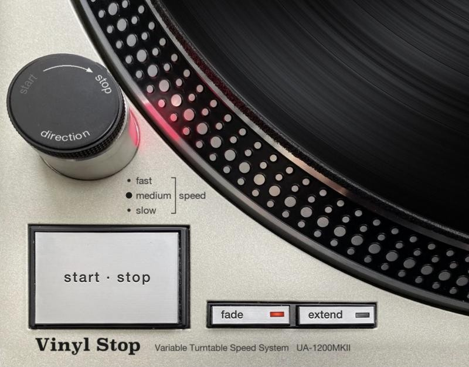

# Vinyl Stop

Replicate the sound of a turntable stopping or starting. This LUNA Add On slows audio to a halt like a record player stopping, or brings it
up to speed from a standstill. A staple effect for modern audio production!



## Install

1. Download `Vinyl-Stop.lunaaddon` from the latest
   [release](../../releases/latest).
2. Double-click it. LUNA asks to add it.
3. Open it from **Add Ons > Windows > Vinyl Stop** while a session is open.

Needs LUNA 3.1.2 or later.

## Use

1. In LUNA, highlight a range on the timeline and select the audio tracks to process.
2. Set the deck:
   - **direction**: click the knob. **stop** slows the range down to silence; **start** brings
     it up from silence.
   - **speed**: **fast** holds speed and then dies, like a tape motor cut off. **medium** is an
     even slowdown. **slow** drops quickly and then drags, like a platter pulled to a stop.
   - **fade**: fades to silence over the slow end.
   - **extend**: lit, the effect runs longer than the range (10%, 30% or 50% by speed), past it
     for a stop and before it for a start. Off, it fits the range.
3. Press **start · stop**.

Each selected track gets one new clip over the range, crossfaded with the audio around it. The
audio stays in time with what comes before a stop and after a start. It is one undo step.

The deck only prints a message when **start · stop** can't run, for example with no range
highlighted or no audio tracks selected.

## How it works

The effect is rendered in the page by reading each
track's source audio, playing it through a continuously changing speed with windowed-sinc
interpolation, building the fade into the samples, uploading the result as a new audio file and
placing it as a clip.

## Develop

Built with the [LUNA Builder SDK](https://github.com/uaudio-labs/luna-builder-sdk) 3.1.2.

| File | Purpose |
|---|---|
| `manifest.json` | What LUNA reads: id, name, window size, entry page. |
| `index.html` | The deck: art, buttons and the engraved legends. |
| `logic.js` | Rendering and session edits, with no DOM. Tests run it against `Luna.MockEngine`. |
| `main.js` | Wiring: connect to LUNA, follow the focused session, run the effect. |
| `img/` | Deck art (2x). |
| `vendor/luna.global.js` | The SDK as a script-tag bundle. Refreshed by `ua-builder pack`. |
| `tests/` | Vitest, no LUNA required. |

`package.json` points `@uaudio/luna-builder-sdk` at a local copy of the SDK. Install the
[LUNA Builder plugin](https://github.com/uaudio-labs/luna-builder-sdk) and point it at yours.

```sh
npm install
npm test                  # against the mock engine
npx ua-builder serve      # http://localhost:8790/ ; LUNA must be running to see live data
npx ua-builder install    # link into LUNA's Add Ons folder
npx ua-builder pack       # build the .lunaaddon
```
